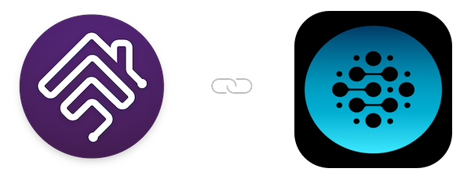

   

## homebridge-controlmyspa

Homebridge plugin to integrate Balboa ControlMySpa hot tubs into HomeKit

 
 

### Plugin Information

- This plugin allows you to control your [ControlMySpa](https://controlmyspa.com) hot tub within HomeKit. The plugin:
  - requires your ControlMySpa account credentials to work
  - connects to the ControlMySpa cloud, the same way the official mobile app does
  - exposes for each spa:
    - a thermostat for the water temperature and heater mode (READY/REST)
    - a switch for each single-speed jet pump and blower, or a fan with a speed slider for two-speed ones
    - a light for each spa light
    - an optional lock for the spa's physical control panel
    - an optional estimated power and energy outlet for Apple Home's Energy view, over Matter (see below)
- This plugin is for spas connected to the **ControlMySpa cloud**. If your Balboa spa uses a local WiFi module instead, [homebridge-balboa-spa](https://github.com/vincedarley/homebridge-plugin-bwaspa) may suit better.

### Prerequisites

- To use this plugin, you will need to already have:
  - [Node](https://nodejs.org): latest version of `v22`, `v24` or `v26` - any other major version is not supported.
  - [Homebridge](https://homebridge.io): `v1.11.4` or above - refer to link for more information and installation instructions.

### Energy Estimate (Apple Home Energy)

A Balboa spa has no electricity meter, and the ControlMySpa cloud reports none. With **Estimate Energy Use** turned on, the plugin works out an estimate instead, the same way [@haresik's Home Assistant integration](https://github.com/haresik/Hares-ControlMySpa) does: on each refresh it sees which components are running, multiplies each by a wattage, and adds up the kWh over time. **These are estimates, good for trends but not for billing.**

The estimate is published as a **Matter outlet** called "*Spa name* Energy". Apple Home shows its live wattage on the tile and adds its use to the Home's Energy totals. HomeKit's own protocol (HAP) has no energy measurements, so Matter is the only way to get the figures into Apple Home. The outlet switches nothing: you still control the spa with the usual accessory, and a tap on the energy tile is set back to on.

**What you need:**

- Homebridge **v2.3.0 or later**, with **Matter turned on** for the bridge this plugin runs on. In the Homebridge UI, open the plugin's bridge settings and turn on "Enable Matter". Leave HAP on as well, since the spa's controls still use it.
- The bridge's **Matter pairing code** added in Apple Home, alongside the HomeKit pairing you already have. The code is printed in the Homebridge log at startup.
- iOS/iPadOS/tvOS **27 or later** on your Apple devices and home hub to see the energy figures.

**What's counted** (all wattages can be changed under *Energy Estimate* in the plugin settings):

| Component | Default | Counted while |
|---|---|---|
| Heater | 2800 W | the spa reports the heater `ON` (not `WAITING`) |
| Jet pump, high | 2200 W | each pump on `HIGH` (or a single-speed pump on) |
| Jet pump, low | 500 W | each two-speed pump on `LOW` |
| Blower | 900 W | each blower on |
| Circulation pump | 400 W | on |
| Light | 10 W | each light on |
| Standby | 0 W | always (controller and electronics) |

Check your spa's manual or the labels on the heater and pumps, and set real figures for a better estimate. The heater usually accounts for most of the total.

**Good to know:**

- Each time the reading changes, the Homebridge log shows what it is made of, for example `Hot Tub Energy 3,200 W: heater 2,800 + circulation pump 400 (total 12.345 kWh)`. Unchanged readings go to the debug log only.
- Some spas don't report their heater to ControlMySpa. If yours doesn't, the log says so once, and the estimate can't include the heater.
- The estimate is only as fine-grained as the refresh rate: a pump that runs for less than one refresh interval may be missed or over-counted.
- If no reading arrives for longer than 10 minutes (or three refresh intervals, if those are longer), for example while Homebridge is down or the cloud is out, that time is not counted.
- The running total is kept in `controlmyspa/energy.json` in the Homebridge storage folder, so it carries on across restarts.
- Apple's Energy view counts bridged accessories in the Home's total but doesn't list them one by one. That is an Apple limitation for every Homebridge Matter accessory. The wattage still shows on the outlet's own tile.
- To leave one spa out, turn on **Hide Energy** for it under *Spa Settings*.

### Dashboard

The plugin's settings page has a **Dashboard** tab showing, for the last 24 hours, 7 days or 30 days:

- the water temperature and set temperature
- the estimated power draw, and the estimated energy per hour or per day
- an activity timeline of when the heater, jets, blower, circulation pump, filter cycles and lights were on
- a list of every on/off change

Hover over any chart for the exact figures. The plugin records a reading at each refresh and keeps 30 days, in `controlmyspa/history-*.jsonl` in the Homebridge storage folder (about 3–4 MB per spa). The energy figures use the wattages under *Energy Estimate*, whether or not the Matter outlet is turned on. To stop recording, turn off **Record History** under *Advanced Settings*.

### Setup

- [Installation](https://github.com/homebridge-plugins/homebridge-controlmyspa/wiki/Installation)
- [Configuration](https://github.com/homebridge-plugins/homebridge-controlmyspa/wiki/Configuration)
- [Beta Version](https://github.com/homebridge-plugins/homebridge-controlmyspa/wiki/Beta-Version)
- [Node Version](https://github.com/homebridge-plugins/homebridge-controlmyspa/wiki/Node-Version)

### Help/About

- [Common Errors](https://github.com/homebridge-plugins/homebridge-controlmyspa/wiki/Common-Errors)
- [Support Request](https://github.com/homebridge-plugins/homebridge-controlmyspa/issues/new/choose)
- [Changelog](https://github.com/homebridge-plugins/homebridge-controlmyspa/blob/latest/CHANGELOG.md)
- [About Me](https://github.com/sponsors/bwp91)

### Credits

- The current ControlMySpa cloud protocol is documented by [@haresik's Home Assistant integration](https://github.com/haresik/Hares-ControlMySpa), which this plugin's api client is based on.
- The original ControlMySpa cloud protocol was first documented by [@VVlasy's controlmyspajs](https://github.com/VVlasy/controlmyspajs).

### Disclaimer

- I am in no way affiliated with Balboa Water Group and this plugin is a personal project that I maintain in my free time.
- Use this plugin entirely at your own risk - please check your spa manually before use if temperature matters to you.
